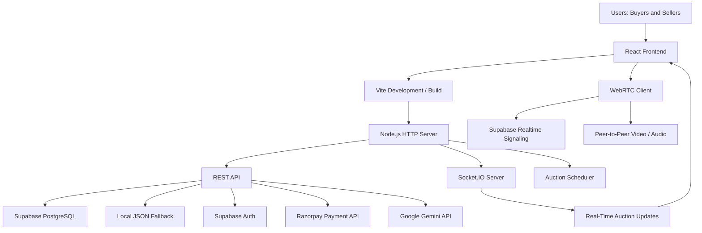
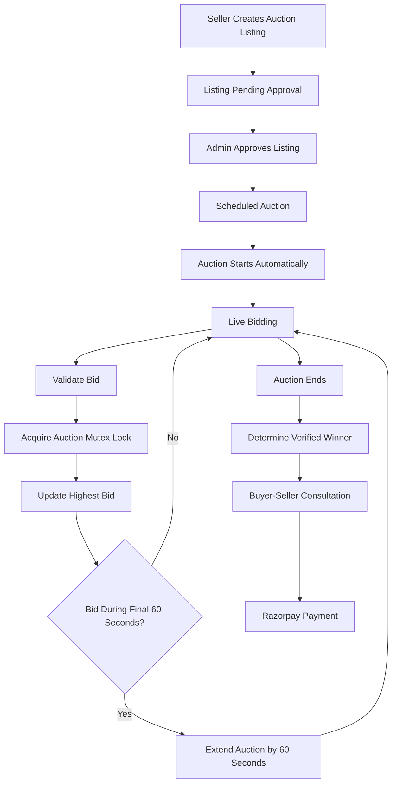
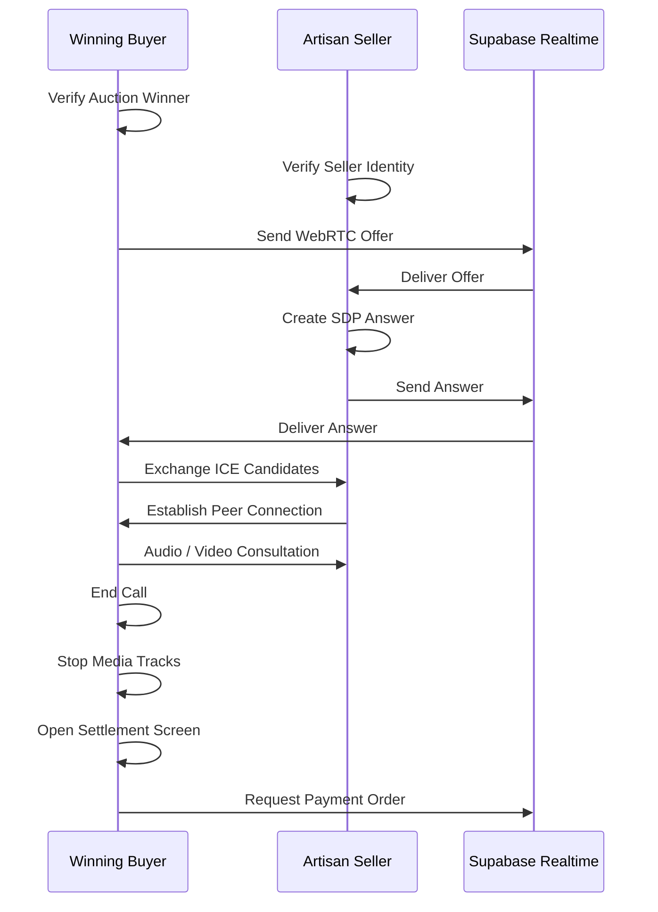

# Veyra — Discover it. Desire it. Bid for it.

<p align="center">

**A Marketplace Where Shopping Meets Live Auctions.**

Discover handcrafted treasures, explore curated collections, participate in real-time auctions, and connect directly with artisans.

[](https://react.dev/)
[](https://vite.dev/)
[](https://nodejs.org/)
[](https://supabase.com/)
[](https://socket.io/)

**Live Website:** https://veyra-2qb1.onrender.com

**GitHub Repository:** https://github.com/jyothsnamenezes2007-prog/Veyra

</p>

---

## 1. Project Overview

**Veyra** is a modern online marketplace that brings traditional e-commerce and live auctions together in one seamless platform.

Unlike conventional shopping websites, Veyra allows users to purchase products directly or participate in scheduled and live auctions to compete for unique items.

The platform focuses on handcrafted products, artistic collections, vintage pieces, and independent artisans.

Veyra also introduces a unique post-auction experience where the winning buyer and seller can connect through a private video consultation before completing payment.

Our goal is to make online shopping more interactive, transparent, personal, and engaging.

## 2. Problem Statement

An interactive marketplace for shopping and real-time live auctions with direct seller interaction.

## 3. Problem Being Addressed

Conventional e-commerce platforms have several limitations:

- **Limited Personal Interaction:** Buyers rarely get an opportunity to communicate directly with sellers.
- **Lack of Auction Experience:** Traditional shopping platforms generally focus on fixed-price purchases.
- **Unfair Bidding Experiences:** Last-second bidding can create unfair competition during auctions.
- **Limited Seller Visibility:** Independent artisans and creators often struggle to showcase their products.
- **Post-Auction Uncertainty:** Buyers may have limited opportunities to connect with sellers after winning an auction.

Veyra addresses these challenges through a unified shopping and auction experience.

## 4. Proposed Solution

Veyra provides a single platform combining:

- A curated online marketplace for direct product purchases.
- Real-time auctions with synchronized bidding.
- Automated proxy bidding with maximum budget limits.
- Anti-sniping protection to prevent last-second auction manipulation.
- AI-assisted proxy bidding reasoning using Google Gemini.
- Private buyer–seller video consultations using WebRTC.
- Secure payment processing through Razorpay.
- Seller dashboards for managing products and auction listings.

By combining these features, Veyra creates a more engaging and interactive marketplace.

## 5. Key Features

### A. Online Marketplace

- Browse products across multiple categories.
- Search products using dynamic search suggestions.
- View detailed product information and image galleries.
- Add products to the shopping cart.
- Maintain a personal wishlist.
- Explore artisan storefronts and featured collections.

### B. Live Auction System

- Participate in scheduled and live auctions.
- Place bids and view real-time bid updates.
- Track auction countdown timers.
- View bidding history.
- Automatic auction starting and ending.
- Anti-sniping protection that extends auctions when valid bids arrive during the final 60 seconds.
- Automatic winner determination.

### C. AI-Powered Proxy Bidding

Veyra supports automated proxy bidding, allowing users to set a maximum bidding amount and preferred increment.

- Users configure their maximum bid limit.
- The system automatically responds to competing bids.
- Google Gemini provides optional AI-assisted bidding reasoning.
- A deterministic bidding engine acts as a fallback.
- Maximum bid limits remain private on the server.

### D. Private Buyer–Seller Video Consultation

After an auction concludes, the verified winning buyer and artisan seller can connect through a private video consultation.

Features include:

- One-to-one audio and video communication.
- Camera and microphone controls.
- Private in-call communication.
- Role-based meeting authorization.
- Automatic call duration tracking.
- Post-call payment transition.

The video consultation uses native WebRTC APIs with Supabase Realtime signaling.

### E. Secure Payment Integration

Veyra integrates Razorpay for post-auction payment settlement.

- Razorpay Checkout integration.
- UPI, cards, net banking, and wallet payment support.
- Backend order generation.
- HMAC-SHA256 payment signature verification.
- Payment amount derived from the authoritative winning bid.

### F. Seller Studio

- Create standard product listings.
- Submit scheduled auction listings.
- Manage submitted products.
- View personal product listings.
- Delete eligible seller-owned products.
- Submit listings for approval.

### G. Authentication and User Management

- User registration and login.
- Supabase authentication.
- Persistent user sessions.
- Password reset functionality.
- Email confirmation handling.
- Authentication-protected shopping, bidding, and selling actions.

---

## 6. Buyer and Seller Workflows

### Buyer Workflow

1. Visit Veyra and browse products without creating an account.
2. Explore product categories or search for specific items.
3. Add products to the wishlist or shopping bag.
4. Sign in or create an account before purchasing.
5. Explore live and upcoming auctions.
6. Place bids or configure automated proxy bidding.
7. Receive real-time auction updates.
8. If the highest bidder when the auction concludes, become the verified winner.
9. Enter the private buyer–seller video consultation.
10. Complete payment through Razorpay Checkout.

### Seller Workflow

1. Create an account or sign in.
2. Access the seller listing portal.
3. Submit a product for direct sale or an auction.
4. Provide product information, images, pricing, and auction details where applicable.
5. Submit the listing for approval.
6. Manage submitted products through My Products.
7. Participate in the post-auction consultation with the verified winning buyer.
8. Complete the post-auction settlement process.

---

## 7. Technology Stack

| Technology | Purpose |
|---|---|
| React 18 | Component-based frontend development |
| ReactDOM | Rendering React components |
| Vite 5 | Development server and production build |
| React Router DOM | Client-side navigation |
| Lucide React | Modern icon library |
| Vanilla CSS | Custom responsive design system |
| Google Fonts | Cormorant Garamond and Inter typography |
| Node.js 20+ | Backend runtime |
| Native HTTP | Backend server and API handling |
| Socket.IO 4 | Real-time bidding and communication |
| Supabase | PostgreSQL database, authentication and realtime signaling |
| WebRTC | Peer-to-peer audio and video communication |
| Google Gemini | AI-assisted proxy bidding reasoning |
| Razorpay | Payment processing |
| Render | Application deployment |

### Frontend

- React
- React Router DOM
- Vite
- Lucide React
- Vanilla CSS

### Backend

- Node.js
- Native `node:http`
- Native `node:crypto`
- Socket.IO
- Custom REST API
- Background auction scheduler

### Database and Authentication

- Supabase PostgreSQL
- Supabase GoTrue Authentication
- Supabase Realtime
- Local JSON database fallback
- Browser localStorage

### External Integrations

- Google Gemini API
- Razorpay Checkout
- Google STUN servers
- Google Fonts
- Unsplash CDN

---

## 8. APIs and Third-Party Integrations

| Service | Purpose | Status |
|---|---|---|
| Supabase PostgreSQL | Product and auction persistence | Integrated |
| Supabase Auth | Registration and authentication | Integrated |
| Supabase Realtime | WebRTC signaling | Integrated |
| Socket.IO | Live auction communication | Integrated |
| Google Gemini REST API | Proxy bidding reasoning | Integrated with fallback |
| Razorpay Orders API | Payment order creation | Integrated |
| Razorpay Checkout | Payment interface | Integrated |
| Google STUN | WebRTC connectivity | Integrated |
| Custom TURN | Restricted network connectivity | Configuration supported |
| Google OAuth | Social authentication | Requires dashboard credentials |
| Google Fonts | Typography | Integrated |
| Unsplash CDN | Product imagery | Integrated |

---

## 9. System Architecture

Veyra follows a full-stack architecture with a React frontend, custom Node.js backend, real-time communication services, and external integrations.



**Architecture overview:**

- React handles the user interface and client-side state.
- Vite manages frontend development and build processes.
- Node.js handles backend operations and API requests.
- Socket.IO synchronizes auction events.
- Supabase provides cloud database and authentication services.
- Gemini assists the proxy bidding engine.
- Razorpay handles payment processing.
- WebRTC enables private buyer–seller communication.

---

## 10. Auction and Bidding Workflow

The auction system is designed to support synchronized bidding, automatic scheduling, and fair auction completion.

### Auction Lifecycle



### Important Auction Mechanisms

**1. Automatic Scheduling**

The backend scheduler checks auction start and end times continuously using a one-second interval.

**2. Mutex Locking**

An in-memory mutex ensures that competing bids for the same auction are processed sequentially, preventing race conditions.

**3. Anti-Sniping**

If a valid bid is received during the final 60 seconds, the auction is extended by another 60 seconds.

**4. Proxy Bidding**

Users can authorize automatic bidding up to their configured maximum budget.

**5. Winner Determination**

The backend determines the authoritative winning bidder when the auction concludes.

---

## 11. WebRTC Video Communication Workflow

Veyra provides private one-to-one video consultations between the winning buyer and the artisan seller.

### Signaling Architecture

The WebRTC implementation uses three signaling mechanisms:

1. **Supabase Realtime:** Exchanges SDP offers, answers, and ICE candidates between remote users.
2. **BroadcastChannel:** Supports local multi-tab communication.
3. **Storage Event Fallback:** Supports synchronization when BroadcastChannel is unavailable.

### Communication Workflow



### Security and Access Control

Meeting access is restricted to:

- Authenticated users.
- The verified winning bidder.
- The seller associated with the auction.
- Auctions that have ended and have an authoritative winning bid.

WebRTC is used for communication, not payment processing.

---

## 12. Repository Structure

```text
Veyra/
│
├── .env.local
├── .gitignore
├── index.html
├── package.json
├── package-lock.json
├── vite.config.js
│
├── server/
│   ├── api.js
│   ├── db.js
│   ├── gemini.js
│   ├── index.js
│   ├── proxyBidding.js
│   ├── scheduler.js
│   ├── socket.js
│   │
│   └── data/
│       ├── db.json
│       └── db.riona-backup.json
│
├── src/
│   ├── App.jsx
│   ├── index.css
│   ├── main.jsx
│   │
│   ├── components/
│   │   ├── AdminAuctionControls.jsx
│   │   ├── AnnouncementBar.jsx
│   │   ├── AuctionCallModal.jsx
│   │   ├── AuctionCard.jsx
│   │   ├── CategoryCarousel.jsx
│   │   ├── CategoryTile.jsx
│   │   ├── Footer.jsx
│   │   ├── HelpAndLegalModal.jsx
│   │   ├── Navbar.jsx
│   │   ├── PhoneVerification.jsx
│   │   ├── ProductCard.jsx
│   │   ├── ProductGallery.jsx
│   │   ├── ProductQuickViewModal.jsx
│   │   ├── ProxyBiddingControls.jsx
│   │   ├── QuickBidModal.jsx
│   │   ├── RecommendedSection.jsx
│   │   ├── SearchBar.jsx
│   │   ├── SearchSuggestionsDropdown.jsx
│   │   ├── SectionHeading.jsx
│   │   ├── SellerReviews.jsx
│   │   ├── ToastContainer.jsx
│   │   ├── UpcomingAuctionRow.jsx
│   │   └── WhyVeyra.jsx
│   │
│   ├── context/
│   │   ├── AuctionContext.jsx
│   │   ├── AuthContext.jsx
│   │   ├── CartContext.jsx
│   │   ├── FollowContext.jsx
│   │   ├── ProductsContext.jsx
│   │   ├── ReviewsContext.jsx
│   │   ├── SellerProfileContext.jsx
│   │   ├── ToastContext.jsx
│   │   └── WishlistContext.jsx
│   │
│   ├── data/
│   │   ├── auctions.js
│   │   ├── products.js
│   │   └── sellers.js
│   │
│   ├── lib/
│   │   ├── searchSuggestions.js
│   │   ├── socket.js
│   │   ├── supabase.js
│   │   └── webrtc.js
│   │
│   └── pages/
│       ├── Account.jsx
│       ├── Auctions.jsx
│       ├── Cart.jsx
│       ├── Categories.jsx
│       ├── Explore.jsx
│       ├── ForgotPassword.jsx
│       ├── Home.jsx
│       ├── LiveAuctionRoom.jsx
│       ├── LiveAuctions.jsx
│       ├── MyProducts.jsx
│       ├── ProductDetails.jsx
│       ├── ResetPassword.jsx
│       ├── Schedule.jsx
│       ├── Sell.jsx
│       ├── SellerShop.jsx
│       ├── Shop.jsx
│       ├── SignIn.jsx
│       ├── SignUp.jsx
│       ├── UpcomingLots.jsx
│       └── Wishlist.jsx
│
├── supabase/
│   ├── config.toml
│   └── seed_catalog.sql
│
└── tests/
    ├── test-auth-fixes.js
    ├── test-complete-auction-workflow.js
    ├── test-demo-auction.js
    ├── test-post-auction-meeting-button.js
    ├── test-proxy-bidding.js
    ├── test-razorpay-call-payment.js
    ├── test-six-fixes.js
    ├── test-socket-migration.js
    ├── test-webrtc-stability.js
    └── test-winner-meeting.js
```

---

## 13. Prerequisites

Before running Veyra locally, make sure you have:

| Requirement | Version |
|---|---|
| Node.js | 20.0.0 or higher |
| npm | 10.0.0 or higher recommended |
| Git | Latest stable version |
| Code Editor | Visual Studio Code recommended |
| Supabase Account | Required for cloud database and authentication |
| Razorpay Account | Required for payment integration |
| Google AI Studio Account | Required for Gemini integration |

---

## 14. Installation and Setup

### Step 1: Clone the Repository

```bash
git clone https://github.com/jyothsnamenezes2007-prog/Veyra.git
```

### Step 2: Navigate to the Project

```bash
cd Veyra
```

### Step 3: Install Dependencies

```bash
npm install
```

### Step 4: Configure Environment Variables

Create a `.env.local` file in the project root.

Add your actual credentials using the environment variable names expected by the application.

---

## 15. Environment Variables

Veyra uses environment variables to configure external services and protect sensitive credentials.

Example configuration:

```env
# Supabase
VITE_SUPABASE_URL=YOUR_SUPABASE_PROJECT_URL
VITE_SUPABASE_PUBLISHABLE_KEY=YOUR_SUPABASE_PUBLISHABLE_KEY

# Razorpay
RAZORPAY_KEY_ID=YOUR_RAZORPAY_KEY_ID
RAZORPAY_KEY_SECRET=YOUR_RAZORPAY_KEY_SECRET

# Gemini AI
GEMINI_API_KEY=YOUR_GEMINI_API_KEY

# WebRTC TURN Configuration (Optional)
VITE_TURN_SERVER_URL=YOUR_TURN_SERVER_URL
VITE_TURN_USERNAME=YOUR_TURN_USERNAME
VITE_TURN_CREDENTIAL=YOUR_TURN_CREDENTIAL
```

**Important:**

- Never upload `.env.local` to GitHub.
- Never expose Razorpay secret keys in frontend code.
- Never expose Gemini API keys publicly.
- Use environment variables in Render for production credentials.
- Only expose frontend-safe Supabase configuration through `VITE_` variables.
- Confirm all variable names against the current application code before deployment.

---

## 16. Running the Application Locally

### Full-Stack Development Mode

Start the development environment:

```bash
npm run dev
```

The custom Vite backend plugin initializes the local backend and Socket.IO services alongside the frontend development server.

Open the local URL displayed in the terminal.

### Standalone Backend Server

To run the backend independently:

```bash
npm run server
```

The standalone Node.js server uses port `3001` by default.

---

## 17. Production Build

To generate an optimized production build:

```bash
npm run build
```

To preview the production build locally:

```bash
npm run preview
```

The generated frontend production files are placed in the `dist/` directory.

---

## 18. Testing

Veyra includes automated test scripts covering major application workflows.

| Test File | Purpose |
|---|---|
| `test-auth-fixes.js` | Authentication and email verification |
| `test-complete-auction-workflow.js` | Complete auction lifecycle |
| `test-demo-auction.js` | Demo auction bidding and timer |
| `test-post-auction-meeting-button.js` | Meeting access buttons |
| `test-proxy-bidding.js` | Automated proxy bidding |
| `test-razorpay-call-payment.js` | Payment settlement |
| `test-six-fixes.js` | Application issue verification |
| `test-socket-migration.js` | Socket.IO communication |
| `test-webrtc-stability.js` | WebRTC signaling stability |
| `test-winner-meeting.js` | Auction winner and meeting verification |

Run an individual test using:

```bash
node tests/test-proxy-bidding.js
```

Replace the filename with the required test script.

---

## 19. Deployment

Veyra is deployed using **Render**.

Live application:

https://veyra-2qb1.onrender.com

### Deployment Overview

1. Push the latest code changes to GitHub.
2. Connect the repository to Render.
3. Configure the Node.js runtime.
4. Set the required build and start commands.
5. Add production environment variables.
6. Configure Supabase, Razorpay, and Gemini credentials.
7. Deploy the application.
8. Verify authentication, database operations, real-time auctions, and payment workflows.

**Production considerations:**

- Use production credentials rather than development keys.
- Configure Supabase authentication redirect URLs for the deployed domain.
- Ensure the backend server is reachable by the frontend.
- Verify WebSocket connectivity.
- Configure Razorpay webhook and signature verification.
- Ensure persistent database storage is configured correctly.

---

## 20. Future Enhancements

Veyra has several opportunities for future development:

1. **Multi-Party Auction Broadcast:** Live one-to-many auction streaming hosted by an auctioneer.
2. **Automated Escrow Milestone Release:** Release seller payments after verified delivery.
3. **Logistics Integration:** Integrate Shiprocket or Delhivery for shipping and courier tracking.
4. **Mobile Applications:** Develop native Android and iOS applications using React Native.

---

## 21. Team Genesis

**Project: Veyra**

*Discover it. Desire it. Bid for it.*

Built with the vision of making online marketplaces more interactive by bringing shopping, live auctions, and personal buyer–seller experiences together.

**Team:** Genesis

**Repository:** https://github.com/jyothsnamenezes2007-prog/Veyra

**Live Application:** https://veyra-2qb1.onrender.com

---

<p align="center">

**VEYRA**

*Where every discovery has a story, and every bid brings it closer.*

</p>
